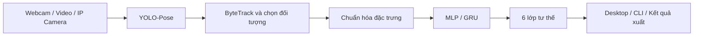

<div align="center">

# 🧍 PoseForge

### Thu thập dữ liệu · Phân tích chuyển động · Nhận diện tư thế

Ứng dụng desktop nhận diện **6 tư thế** từ webcam, video và camera IP,
kết hợp **YOLO-Pose**, **ByteTrack** và mô hình phân loại **MLP / GRU**.


[🚀 Chạy nhanh](#-chạy-nhanh-trên-windows) ·
[✨ Tính năng](#-tính-năng) ·
[🧠 Huấn luyện](#-huấn-luyện-mô-hình) ·
[🛠️ Xử lý lỗi](#️-xử-lý-lỗi-thường-gặp)

</div>

---

## 📖 Giới thiệu

**PoseForge** cung cấp quy trình từ thu thập dữ liệu tư thế đến huấn luyện và chạy nhận diện. Hệ thống trích xuất keypoint cơ thể, theo dõi đối tượng qua các khung hình, chuẩn hóa đặc trưng và dự đoán tư thế bằng mô hình đã huấn luyện.

Repository gồm ba phần chính:

| Thành phần | Mục đích | Điểm khởi chạy |
| :--- | :--- | :--- |
| 🎥 **Collector** | Thu thập video và keypoint, quản lý dữ liệu ghi hình | `collector/main.py` |
| 🧠 **Training** | Kiểm tra dữ liệu, chia tập, huấn luyện, đánh giá và xuất model | `scripts/train_poseforge.py` |
| 🖥️ **Inference** | Nhận diện trên giao diện desktop hoặc dòng lệnh | `inference.gui` / `inference.run` |

> Các lệnh bên dưới được thực hiện tại thư mục **`PoseForge_Reposory`** bằng **PowerShell**. `shared/pose_training.py` là module xử lý huấn luyện; sử dụng các điểm khởi chạy trong bảng để chạy ứng dụng.

## 📑 Mục lục

- [✨ Tính năng](#-tính-năng)
- [🏷️ Các lớp tư thế](#️-các-lớp-tư-thế)
- [⚙️ Yêu cầu và cài đặt](#️-yêu-cầu-và-cài-đặt)
- [🚀 Chạy nhanh trên Windows](#-chạy-nhanh-trên-windows)
- [🎥 Thu thập dữ liệu](#-thu-thập-dữ-liệu)
- [⌨️ Nhận diện bằng dòng lệnh](#️-nhận-diện-bằng-dòng-lệnh)
- [🧠 Huấn luyện mô hình](#-huấn-luyện-mô-hình)
- [🏗️ Kiến trúc và cấu trúc thư mục](#️-kiến-trúc-và-cấu-trúc-thư-mục)
- [📦 Model và kết quả đầu ra](#-model-và-kết-quả-đầu-ra)
- [🧪 Kiểm thử](#-kiểm-thử)
- [🛠️ Xử lý lỗi thường gặp](#️-xử-lý-lỗi-thường-gặp)
- [📚 Tài liệu liên quan](#-tài-liệu-liên-quan)

## ✨ Tính năng

| Nhóm | Khả năng |
| :--- | :--- |
| **Nguồn đầu vào** | Webcam USB, video cục bộ, luồng HTTP/MJPEG và RTSP được OpenCV hỗ trợ |
| **Phân tích tư thế** | YOLO11n-Pose, ByteTrack và logic lựa chọn đối tượng |
| **Phân loại** | MLP mặc định; GRU-16 và GRU-32 khi bundle hợp lệ có sẵn |
| **Giao diện** | PySide6, tối đa 4 nguồn, chọn vùng ROI, điều khiển START / END |
| **Theo dõi hiệu năng** | FPS của YOLO, classifier, pipeline và hiển thị trực tiếp |
| **Xuất kết quả** | Video có chú thích khi bật xuất video; log, cấu hình và thông tin model |
| **Huấn luyện** | Audit, chuẩn bị dữ liệu, baseline, cải tiến, hoàn thiện và xuất ONNX |
| **Tái lập thí nghiệm** | Run có phiên bản, lưu cấu hình, checkpoint và hỗ trợ resume |

## 🏷️ Các lớp tư thế

| ID | Tư thế |
| :---: | :--- |
| `0` | 🪑 Ngồi thẳng |
| `1` | 🙇 Cúi gập / gù lưng |
| `2` | 💤 Gục xuống bàn |
| `3` | ↩️ Ngả người ra sau |
| `4` | ↔️ Nghiêng / quay sang bên |
| `5` | ✋ Giơ tay phát biểu |

Lớp `4` bao gồm cả hai hướng trái và phải. Tên nhãn và thứ tự thực tế được đọc từ model bundle.

## ⚙️ Yêu cầu và cài đặt

### Môi trường

- **Python 3.11** cho hướng dẫn Windows này.
- Webcam hoặc video nếu muốn thử nhận diện.
- Model YOLO-Pose và bundle phân loại có sẵn tại máy.
- GPU NVIDIA với PyTorch hỗ trợ CUDA nếu chọn `cuda:0`; có thể chọn `cpu` khi chạy nhận diện.

### Dùng môi trường đã có

Nếu project đã có `.venv`, thử kiểm tra trước:

```powershell
cd C:\Users\nftvi\Downloads\ChanhNMCE180818_Lab02\PoseForge_Reposory
.\.venv\Scripts\python.exe --version
.\.venv\Scripts\python.exe -c "import PySide6, cv2, torch, ultralytics, onnxruntime; print('Dependencies OK')"
```

Các ví dụ gọi trực tiếp Python trong `.venv`, không cần kích hoạt môi trường.

### Tạo môi trường mới

Chỉ thực hiện nếu chưa có môi trường phù hợp:

```powershell
py -3.11 -m venv .venv
.\.venv\Scripts\python.exe -m pip install --upgrade pip
.\.venv\Scripts\python.exe -m pip install -r requirements.txt
```

`requirements.txt` gốc bao gồm dependency của collector, YOLO-Pose, ONNX và kiểm thử. Nếu cần CUDA, cài bản PyTorch tương thích với GPU và driver của máy, rồi kiểm tra:

```powershell
.\.venv\Scripts\python.exe -c "import torch; print('Torch:', torch.__version__); print('CUDA:', torch.cuda.is_available())"
```

> **Model và dữ liệu được lưu riêng:** `.gitignore` loại trừ `artifacts/`, `.venv/` và các file model/video. Một bản clone mã nguồn có thể chưa có các tài nguyên này. Cần cung cấp model và dữ liệu tương ứng trước khi chạy; cài dependency không khôi phục chúng.

## 🚀 Chạy nhanh trên Windows

### 1. Kiểm tra model

```powershell
Test-Path artifacts\pretrained\yolo11n-pose.pt
Test-Path artifacts\models\mlp_wide_full_real_dataset\v001\model_final.pt
Test-Path artifacts\models\mlp_wide_full_real_dataset\v001\model_final.onnx
```

Các đường dẫn trên thuộc cấu hình mặc định. Bundle cần cả metadata và cấu hình đi kèm, không chỉ file trọng số.

### 2. Mở giao diện

```powershell
.\.venv\Scripts\python.exe -m inference.gui
```

### 3. Bắt đầu nhận diện

1. Chọn model; mặc định là **Full Dataset MLP v001**.
2. Nhập `0` để dùng webcam mặc định, hoặc bấm **Video…** để chọn video.
3. Nếu máy không hỗ trợ CUDA, chọn **YOLO CPU** trong **Advanced Settings**.
4. Bấm **START**, chờ khởi tạo model và mở nguồn.
5. Quan sát tư thế, xác suất và thông số hiệu năng.
6. Bấm **END** để dừng và giải phóng nguồn.

Có thể dùng **Add Source** để thêm nguồn, tối đa bốn nguồn. Mỗi nguồn có trạng thái theo dõi và xử lý riêng; số nguồn càng nhiều càng cần thêm tài nguyên. Dừng bằng **END** trước khi đổi model hoặc cấu hình nguồn.

**ROI:** khi đã có hình ảnh, bấm **Select ROI** rồi kéo vùng cần quan sát; dùng **Enable ROI** để bật/tắt và **Reset ROI** để xóa vùng chọn.

> Khi khởi chạy, giao diện kiểm tra các bundle cục bộ. Camera được mở khi bấm **START**. Tùy chọn ghi video mặc định tắt; bật trong **Advanced Settings** khi cần lưu.

## 🎥 Thu thập dữ liệu

Mở collector từ thư mục gốc project:

```powershell
.\.venv\Scripts\python.exe collector\main.py
```

Dữ liệu và cấu hình runtime mặc định nằm tại:

```text
artifacts/collector_runtime/Real_Posture_Dataset/
```

Để mở một thư mục dữ liệu cụ thể:

```powershell
.\.venv\Scripts\python.exe collector\main.py --data "D:\Datasets\Real_Posture_Dataset"
```

Nếu ứng dụng báo còn thư mục dữ liệu cũ `collector/Real_Posture_Dataset`, đóng collector rồi thực hiện migration theo công cụ có sẵn:

```powershell
.\.venv\Scripts\python.exe -B scripts\migrate_collector_runtime.py --apply
```

Xem thêm [hướng dẫn Collector](collector/README.md).

## ⌨️ Nhận diện bằng dòng lệnh

Các ví dụ dùng **YOLO CPU** và **ONNX classifier trên CPU** để dễ thử trên máy không có CUDA. Thay `--device cpu` bằng `--device cuda:0` khi CUDA đã hoạt động.

### Webcam

```powershell
.\.venv\Scripts\python.exe -m inference.run --source 0 --mode camera --device cpu --backend onnx --cls-device cpu --display
```

Nhấn **Q** trong cửa sổ OpenCV để dừng; có thể dùng **Ctrl+C** trong terminal.

### Video và xuất video có chú thích

Thay đường dẫn ví dụ bằng file thật trên máy:

```powershell
.\.venv\Scripts\python.exe -m inference.run --source "D:\Videos\demo.mp4" --mode video --device cpu --backend onnx --cls-device cpu --headless --export-video --name demo_video
```

Thêm `--max-frames 120` để chạy thử 120 khung hình. Dùng `--display` thay `--headless` nếu muốn mở cửa sổ xem.

### Ảnh tĩnh

```powershell
.\.venv\Scripts\python.exe -m inference.run --source "D:\Images\posture.jpg" --mode image --device cpu --headless
```

### Camera IP

```powershell
.\.venv\Scripts\python.exe -m inference.run --source "rtsp://CAMERA_HOST:554/STREAM_PATH" --mode camera --device cpu --display
```

Thay URL bằng địa chỉ stream thực tế do camera hoặc ứng dụng cung cấp. Có thể truyền nhiều lần `--source` trong chế độ `camera`.

| Tham số | Ý nghĩa |
| :--- | :--- |
| `--model PATH` | Chọn thư mục bundle phân loại |
| `--pose PATH` | Chọn trọng số YOLO-Pose |
| `--device cpu` / `cuda:0` | Thiết bị chạy YOLO |
| `--backend onnx` / `pt` | Backend của classifier |
| `--cls-device cpu` | Thiết bị classifier, tách biệt với YOLO |
| `--headless` | Chạy không mở cửa sổ |
| `--display` | Mở cửa sổ OpenCV |
| `--export-video` | Bật lưu video có chú thích |
| `--max-seconds N` | Giới hạn thời gian chạy camera |
| `--timestamps PATH` | CSV timestamp gốc cho video sử dụng GRU |

Xem toàn bộ tùy chọn bằng `.\.venv\Scripts\python.exe -m inference.run --help`.

## 🧠 Huấn luyện mô hình

### Quy trình MLP theo subject

Workflow mặc định dùng dữ liệu tại `artifacts/dataset_working/Real_Posture_Dataset`. Cần có đầy đủ dữ liệu và các artifact nguồn mà bước audit yêu cầu; trọng số inference không đủ để tái chạy huấn luyện.

```text
Audit → Prepare → Baseline → Improve → Finalize → Export
```

**Bước 1 — Kiểm tra và chuẩn bị dữ liệu:** chọn thư mục báo cáo mới để giữ lại kết quả audit trước đó.

```powershell
$Reports = 'artifacts/reports/my_training_v001'
.\.venv\Scripts\python.exe scripts\train_poseforge.py --stage audit --reports $Reports
.\.venv\Scripts\python.exe scripts\train_poseforge.py --stage prepare --reports $Reports
```

**Bước 2 — Huấn luyện và xuất model:** thay giá trị `$Run` bằng thư mục run thực tế được bước `prepare` tạo ra.

```powershell
$Run = 'artifacts/training/real_vNNN'
.\.venv\Scripts\python.exe scripts\train_poseforge.py --stage baseline --run $Run --device cuda:0
.\.venv\Scripts\python.exe scripts\train_poseforge.py --stage improve --run $Run --device cuda:0
.\.venv\Scripts\python.exe scripts\train_poseforge.py --stage finalize --run $Run --device cuda:0
.\.venv\Scripts\python.exe scripts\train_poseforge.py --stage export --run $Run
```

Có thể chỉ định `--device cpu` nếu không có CUDA. Khi đã yêu cầu CUDA nhưng CUDA không khả dụng, workflow báo lỗi.

**Tiếp tục run bị gián đoạn:** giữ nguyên cấu hình và thêm `--resume` vào bước huấn luyện cần tiếp tục.

```powershell
.\.venv\Scripts\python.exe scripts\train_poseforge.py --stage baseline --run $Run --device cuda:0 --resume
```

### Các hướng thí nghiệm khác

| Chiến lược | Tham số | Mục đích |
| :--- | :--- | :--- |
| Subject-wise | `--split-strategy subject_wise` | Workflow MLP mặc định |
| Temporal within take | `--split-strategy temporal_within_take` | Chia theo thời gian trong take, có vùng loại trừ quanh ranh giới |
| Take-level | `--split-strategy take_level` | Workflow chuỗi và thí nghiệm GRU-16 / GRU-32 |

Các chiến lược có yêu cầu nguồn và thứ tự stage riêng. Xem [tài liệu huấn luyện Windows](docs/TRAINING_WINDOWS.md) và trợ giúp CLI trước khi chạy:

```powershell
.\.venv\Scripts\python.exe scripts\train_poseforge.py --help
```

> **Đọc kết quả đúng ngữ cảnh:** model huấn luyện trên toàn bộ dữ liệu và model dùng cho đánh giá holdout có mục đích khác nhau. Khi báo cáo accuracy/F1, ghi rõ chiến lược chia tập, model, run và tập đánh giá tương ứng.

## 🏗️ Kiến trúc và cấu trúc thư mục



Đặc trưng dùng hợp đồng `pose13_xy_conf_mask_causal_v2`: **13 keypoint × 4 giá trị = 52 đầu vào**. Mỗi keypoint gồm tọa độ `x`, `y`, confidence và mask. GRU bổ sung ngữ cảnh chuỗi theo thời gian.

```text
PoseForge_Reposory/
├── collector/              # Giao diện và logic thu thập dữ liệu
│   ├── main.py
│   └── posture_collector/
├── inference/              # Desktop, CLI và pipeline nhận diện
│   ├── gui.py
│   ├── run.py
│   ├── pipeline.py
│   └── models.py
├── shared/                 # Đặc trưng, model và logic training dùng chung
│   ├── pose_features.py
│   ├── pose_training.py
│   ├── real_training.py
│   ├── mlp_model.py
│   └── gru_model.py
├── scripts/                # Công cụ training, audit, export và verification
├── configs/                # Cấu hình thí nghiệm
├── tests/                  # Kiểm thử cấp project
├── docs/                   # Hướng dẫn vận hành
├── notebooks/              # Notebook nghiên cứu
├── reports/                # Tài liệu báo cáo
├── artifacts/              # Dữ liệu, model, thí nghiệm và kết quả cục bộ
├── requirements.txt        # Điểm cài dependency chung
└── README.md
```

## 📦 Model và kết quả đầu ra

| Tài nguyên | Đường dẫn mặc định |
| :--- | :--- |
| YOLO-Pose | `artifacts/pretrained/yolo11n-pose.pt` |
| Bundle phân loại mặc định | `artifacts/models/mlp_wide_full_real_dataset/v001/` |
| Runtime collector | `artifacts/collector_runtime/Real_Posture_Dataset/` |
| Dữ liệu làm việc cho training | `artifacts/dataset_working/Real_Posture_Dataset/` |
| Run huấn luyện | `artifacts/training/` |
| Thí nghiệm temporal / GRU | `artifacts/experiments/` |
| Báo cáo sinh tự động | `artifacts/reports/` |
| Kết quả inference mới | `artifacts/inference_runs/` |

Bundle mặc định hiện có checkpoint PyTorch, ONNX và các file metadata như `model_config.json`, `feature_contract.json`, `label_map.json` và `inference_labels.json`.

Desktop tạo thư mục `desktop_<timestamp>_vNNN/source_NN/`; CLI tạo thư mục run có tên và phiên bản. Tùy chế độ và tùy chọn xuất, kết quả có thể gồm:

- Cấu hình chạy và thông tin nguồn gốc model.
- Dự đoán CSV / JSONL, xác suất từng lớp và trạng thái theo dõi.
- Báo cáo hiệu năng, telemetry và báo cáo shutdown của desktop.
- Ảnh hoặc video có chú thích khi chế độ tương ứng được sử dụng.

**Lưu ý với GRU:** video offline cần CSV timestamp thu nhận gốc tương ứng; FPS của file không thay thế timestamp. Với nguồn trực tiếp, GRU cần tích lũy đủ ngữ cảnh hợp lệ trước khi đưa ra dự đoán.

## 🧪 Kiểm thử

Chạy từ thư mục gốc project với môi trường đã cài dependency:

```powershell
$env:PYTHONUTF8 = '1'
.\.venv\Scripts\python.exe -m pytest -q
```

Chạy riêng nhóm kiểm thử desktop inference:

```powershell
.\.venv\Scripts\python.exe -m pytest tests\test_inference_desktop.py -q
```

Các kiểm thử tích hợp có thể cần tài nguyên model hoặc dữ liệu cục bộ. Kiểm thử tự động không thay thế việc thử camera thực tế trên máy triển khai.

## 🛠️ Xử lý lỗi thường gặp

| Hiện tượng | Hướng xử lý |
| :--- | :--- |
| `ModuleNotFoundError` | Gọi đúng `.venv\Scripts\python.exe`; kiểm tra dependency trong môi trường đó |
| Không tìm thấy model | Kiểm tra `artifacts/pretrained/`, bundle mặc định và metadata; chọn `--model` nếu dùng bundle khác |
| CUDA không khả dụng | Chọn YOLO CPU trên GUI hoặc `--device cpu`; kiểm tra PyTorch và driver nếu cần GPU |
| Lỗi ONNX Runtime | Kiểm tra gói `onnxruntime`; chọn PT rõ ràng nếu bundle PT đã được xác nhận hợp lệ |
| Webcam không mở | Cho phép quyền camera trong Windows, đóng ứng dụng đang giữ camera và kiểm tra index nguồn |
| Camera IP mất kết nối | Kiểm tra URL stream, mạng và ứng dụng phát; chờ trạng thái kết nối lại hoặc END rồi START |
| Giao diện Qt không hiện | Dùng đúng môi trường PySide6 và xóa `QT_QPA_PLATFORM=offscreen` nếu từng đặt để kiểm thử |
| Báo dữ liệu collector cũ | Chỉ định `--data` hoặc đóng collector và chạy công cụ migration |
| Audit đã tồn tại | Dùng `--reports` trỏ tới một thư mục báo cáo mới cho cả audit và prepare |
| GRU báo thiếu timestamp | Cung cấp CSV timestamp gốc bằng `--timestamps` hoặc sidecar đúng quy ước |
| FPS thấp khi mở nhiều nguồn | Giảm số nguồn, tắt xuất video khi không cần và chọn thiết bị YOLO phù hợp |

Không cài đồng thời hai bản phân phối `onnxruntime` và `onnxruntime-gpu` trong cùng môi trường. Cấu hình classifier mặc định dùng ONNX Runtime CPU.

## 📚 Tài liệu liên quan

- [🖥️ Hướng dẫn inference trên Windows](docs/INFERENCE_WINDOWS.md)
- [🧠 Hướng dẫn training trên Windows](docs/TRAINING_WINDOWS.md)
- [🔍 Kiểm chứng inference](docs/INFERENCE_VERIFICATION.md)
- [🎥 Hướng dẫn Collector](collector/README.md)
- [⚙️ Cấu hình baseline](configs/training_real_baseline.json)

Các báo cáo thực nghiệm sinh tự động nằm trong `artifacts/reports/` trên máy có dữ liệu; thư mục này không được Git theo dõi theo cấu hình hiện tại.

---

<div align="center">

**PoseForge** · Từ dữ liệu tư thế đến ứng dụng nhận diện

<sub>Python · YOLO-Pose · ByteTrack · PyTorch · ONNX Runtime · PySide6</sub>

</div>
